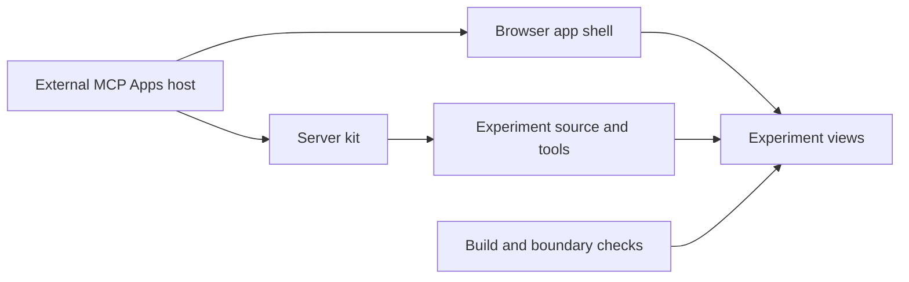

# Explore Nessa extensions

This workspace builds MCP servers with small embedded apps. Today its one extension displays experiment results: it does not launch experiments or decide which changes win. Extension authors use the shared browser bridge and server kit; a host supplies the conversation, permissions and sandbox.

Start with [running the current extension](running.md), [reading an experiment](services/experiments/README.md), [connecting an app to its host](services/app-shell/README.md), or [defining and serving tools](services/server-kit/README.md). The [feature inventory](inventory.md) maps every source responsibility, including development helpers. [Evidence and limits](verification.md) separates executed tests from models and historical host captures.

The current executable uses the sample source over stdio. Server-kit also implements a loopback HTTP API, but the executable does not select it. Packages are private at this checkpoint; README installation examples describe the intended publishing surface. The app and server are implemented, while a real experiment harness and production publication remain separate work.
