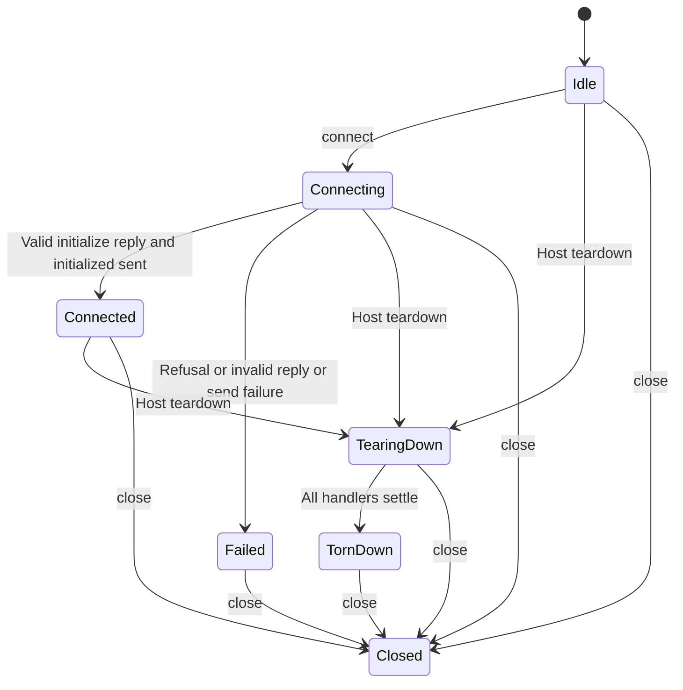

# Connect and tear down

An app may send normal host requests after initialization completes. The bridge sends the initialized notification before publishing connected state, so a subscriber cannot begin ordinary work before that handshake step. Calling connect again shares the original attempt while connecting or already connected; it does not reconnect a failed, closed or completed teardown bridge.

## What teardown waits for

The bridge waits for all registered teardown handlers with `Promise.allSettled`. There is no timeout. If a handler never settles, teardown remains waiting. If a handler rejects, a tearing-down bridge still enters torn-down state and answers the host with an error. A bridge already closed stays closed; an already failed bridge retains its failure. A successful acknowledgement establishes handler settlement, not a universal guarantee that outside work stopped.

Handlers may call through the bridge during teardown only when that bridge had already connected. Teardown before initialization does not grant permission to send. A late initialize reply cannot revive a bridge after teardown or close. `close()` removes transport listening and rejects pending local requests; mountApp's unmount also stops size observation and unmounts React. It is not the host's asynchronous teardown protocol.

## Model boundary

The selected bounded model checks handshake publication and late-initialize admission. It will not prove handler completion, host cleanup, transport delivery or React ordering. Existing bridge and conformance tests exercise those concrete adapters within their fixtures.
