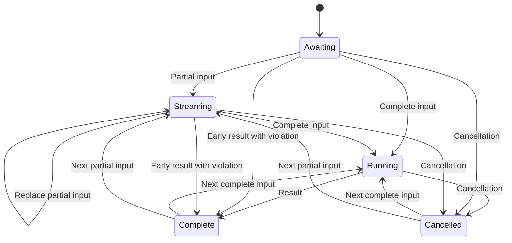

# Read the opening tool call

The opening tool call supplies the app's partial input, complete input and result or cancellation. Its reducer returns replacement values; it does not mutate a saved conversation or persist a tool execution. Notifications carry no call ID, so their sequence determines which opening is current.

Repeated complete input while running, partial input after complete input, and a second settlement are reported and ignored according to the reducer. A result before full input is retained with an out-of-order violation, so the UI can still show it. A fresh input after settlement begins the next opening; it does not append to the prior result. Tool cancellation describes the host notification and does not prove that any remote process was killed.

React's `useToolInput` returns full input only once available; `useToolResult` returns a result only for complete. The experiment app also reads the current phase and result object identity so a new result with the same experiment ID can still replace its snapshot. This notification contract is covered by reducer/conformance tests, rather than an invented persisted call lifecycle.
