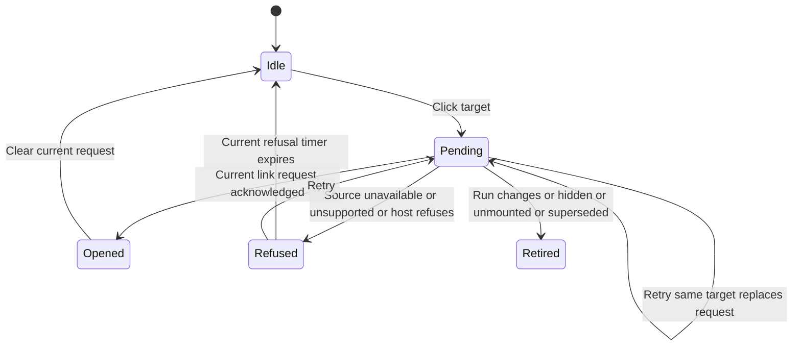

# Open a changed file

Clicking a changed file asks the source how it can be opened, then asks the host to open a supported link. The current sample source returns an unavailable reason. A server download description is valid protocol data, but this app refuses it because it does not implement a download surface.

## What retirement prevents

Each file target and the whole-change target has its own latest request. The owner requires the component to remain mounted, the request version to match and the request to remain latest for its target. That version, called a generation in the code, increments when the experiment, run or active/hidden status changes. This resets the request machine, so hiding the view retires its earlier requests. A newer request retires the old request for that target; a different target may proceed concurrently. Old completions and old four-second refusal timers cannot overwrite newer state.

The open port carries a callback, called the current predicate, that checks whether the request still belongs to this mounted view and target. Pagination consults it before asking for another page, and the host adapter checks it again before `openLink`. Thus a stale final answer cannot initiate a new link request. Once a link request has already been sent, hiding the view or changing runs cannot undo the host's action. A local failure or cancellation is not evidence that nothing opened.

## What a result means

The request sends the selected experiment, run and optional path. On return, the app checks that the local request is still current, then validates the opening shape and HTTP(S) URL. It does not compare echoed experiment, run or path fields in the response. Local request ownership therefore does not prove that a returned URL names the requested resource. Links also require the host's openLinks capability. Host refusal stays visible. An unavailable result explains why no link is available; a download result says this app cannot offer that download. An acknowledged opening clears the request back to idle; Opened in the chart is the operation outcome, not a persistent success indicator. The refusal timer clears only the current notice, not a remote operation. Retrying begins a fresh source read; there is no automatic retry loop.

The selected model covers two targets, replacement/generation and actual link-effect admission. It will not claim to cancel an issued host action or prove browser navigation succeeds.
