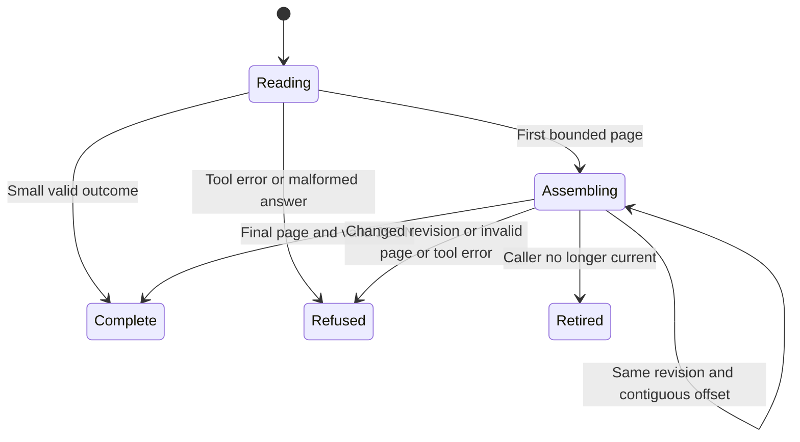

# Read a large changing result

A large read is assembled completely before its record is decoded and published. A continuation identifies the hash of the complete outcome, not a mutable experiment name. If the source changes during assembly, the read fails instead of mixing two revisions.

## A failed read is not a retained snapshot

The server re-reads and validates the source on every page, recomputes the complete outcome hash and refuses a continuation whose revision no longer matches. It retains no snapshot cache. Reopening starts a new read, which can fail again if the source keeps changing. Partial assembled bytes are not published as a valid experiment.

The client requires stable revision and total, exact contiguous offsets, forward progress and no next cursor on the final page. It parses the completed JSON only after those checks. Server refusal is preserved; malformed pages fail locally. When a current predicate is provided, this callback checks whether the read still belongs to the current view before each continuation call. A first call may already have started, and retirement cannot undo that source read or a host effect already requested.

## Wire and model bounds

The server escapes Unicode to ASCII before splitting and budgets the page's cost under double JSON encoding. Small outcomes use the ordinary shape; large slices use a 40,000-byte budget with space for text/envelopes under the host's 57,344-byte limit. The final in-memory result and rendering cost remain unbounded by that per-call limit. The selected model checks revision/offset assembly with two revisions and two slices, not hashing, Unicode encoding, exact byte budgets or actual host enforcement. Publishing here means handing a completed result to the caller; it does not mean saving it durably.
